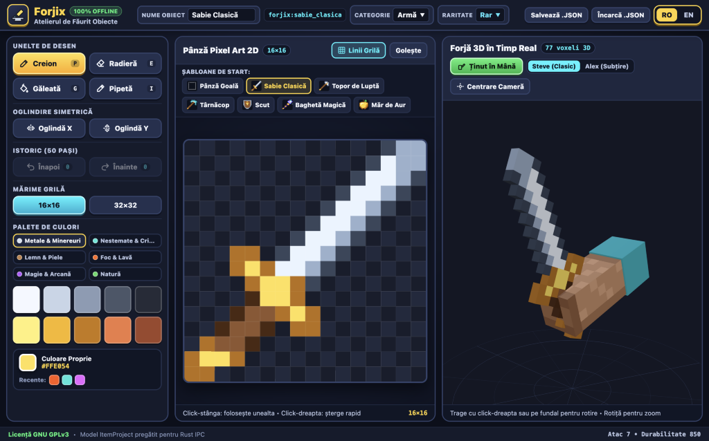
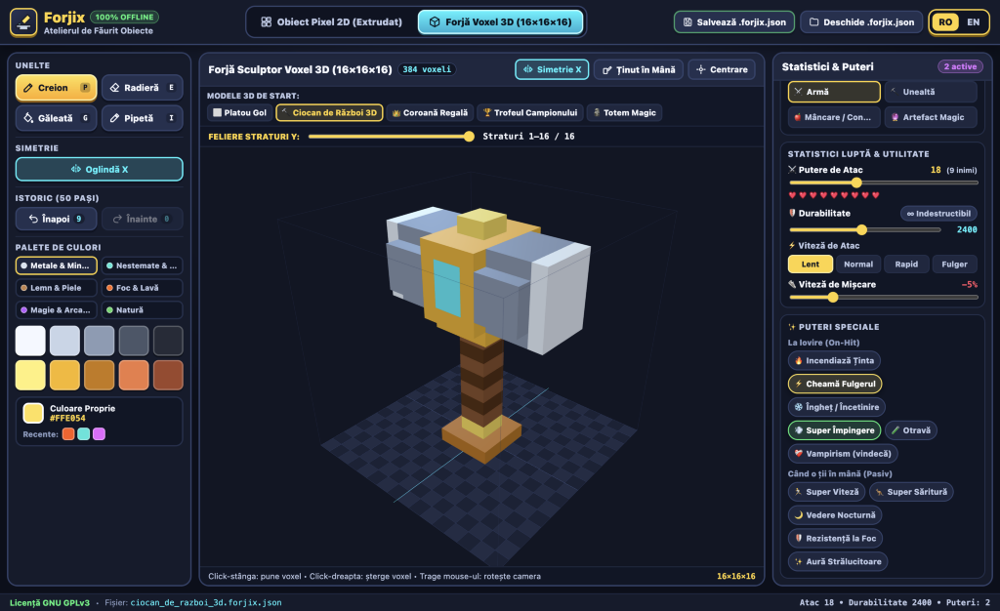
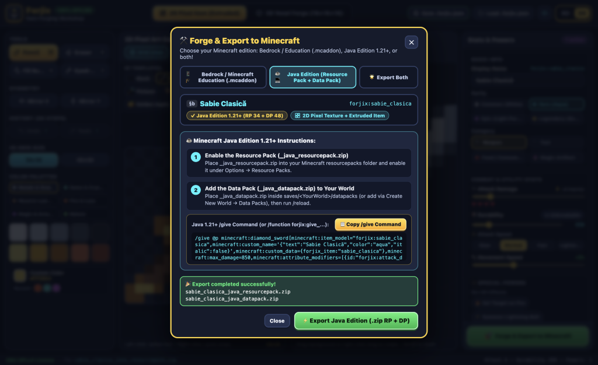
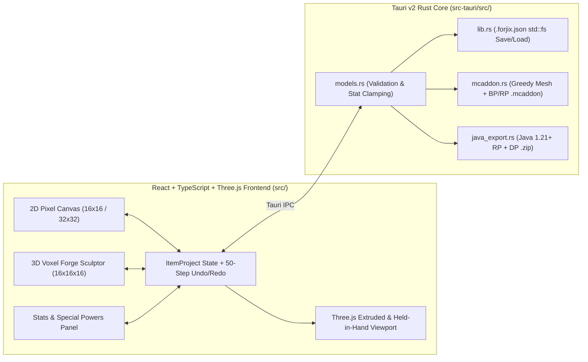

<div align="center">
  

  # Forjix

  **Offline 2D & 3D Minecraft Item Forging Desktop Studio for Kids (Ages 6–12)**

  [](./LICENSE)
  [](./.github/workflows/ci.yml)
  [](./.github/workflows/release.yml)
  [](https://v2.tauri.app/)
  [](https://www.rust-lang.org/)
  [](https://threejs.org/)
  [](#privacy--offline-first-design)
</div>

---

**Forjix** is a cross-platform, 100% offline desktop application built with **Tauri v2**, **Rust**, **React/TypeScript**, and **Three.js** that empowers children ages **6–12** (alongside parents and educators) to design, sculpt, configure, and export custom **Minecraft** weapons, tools, food, and magical artifacts—without writing a single line of code or JSON.

Forged creations export directly to **Minecraft Bedrock Edition**, **Minecraft Education** (`.mcaddon`), and **Minecraft Java Edition 1.21+** (`_java_resourcepack.zip` + `_java_datapack.zip`).

---

## Screenshots

### 1. 2D Pixel Editor & Real-Time Extruded "Held in Hand" 3D Preview


### 2. 3D Voxel Forge (`16×16×16`) Sculptor & Visual Stats/Powers Builder


### 3. Unified Multi-Edition Minecraft Exporter (Bedrock, Education & Java 1.21+)


---

## Key Features

### Kid-Friendly, Bilingual & 100% Offline
- **Default Romanian (`RO`) + 1-Click `RO | EN` Toggle**: Instant header language switching between Romanian (*Atelierul de Făurit Obiecte*) and English (*Item Forging Workshop*).
- **Privacy & Offline-First Design**: Zero external runtime network requests, zero accounts, zero telemetry, strict Content Security Policy (CSP), and procedural Web Audio sound synthesis with a header mute toggle.
- **50-Step Undo/Redo History**: Continuous brush-stroke batching ensures every stroke, flood fill, template switch, or voxel edit can be undone and redone cleanly.

### Mode 1 — 2D Pixel Item Editor (Extruded)
- **Interactive Crisp Pixel Canvas**: Paint on **16×16** or **32×32** grids (with stroke-preserving resampling when switching grid sizes) and toggleable pixel grid lines.
- **Drawing Tools & Symmetry**: **Pencil (`P`)**, **Eraser (`E`)**, **Fill Bucket (`G`/`B`)**, **Eyedropper (`I`)**, quick right-click erase, and **Mirror X (`X`) / Mirror Y (`M`)** symmetry with live axis guides and ghost previews.
- **6 Curated Palettes + Custom Color Picker**: *Metals & Ores*, *Gems & Crystals*, *Wood & Leather*, *Fire & Lava*, *Magic & Arcane*, and *Nature*, plus a custom color picker with recent swatches.
- **7 Starter 2D Templates**: *Blank*, *Classic Sword*, *Battle Axe*, *Pickaxe*, *Shield*, *Magic Wand*, and *Golden Apple*.
- **Real-Time 3D Extruded Viewport**: Automatically extrudes every opaque pixel into an internal-face-culled **1-voxel-thick 3D mesh** matching Minecraft's native held-item extrusion, with smooth `OrbitControls` (auto-freezing camera orbit while actively painting) and a toggleable **Held in Hand** **Steve / Alex** blocky right arm preview.

### Mode 2 — 3D Voxel Forge (`16×16×16`)
- **Click-to-Sculpt 3D Build Plate**: Left-click to stack colored voxels on faces or the `16×16` build plate, right-click to remove voxels, 3D flood-recolor connected regions with the Fill Bucket, and orbit smoothly by dragging.
- **Y-Level Layer Slicer (`1–16`)**: Slice horizontal layers to inspect and sculpt inside hollow crowns, cups, and totems with solid exposed cross-sections.
- **X-Symmetry Toggle**: Real-time mirrored voxel placement and removal with dual wireframe hover previews.
- **Starter 3D Presets**: *3D War Hammer*, *Royal Crown*, *Champion Trophy*, *Magic Totem*, and *Empty Plate*.

### Visual Stats & Special Powers Configurator
- **Identity & Rarity**: Custom Display Name (auto-generating a valid `forjix:<slug>` ID), **Rarity** (*Common/White*, *Rare/Aqua*, *Epic/Light Purple*, *Legendary/Gold*), and **Category** (*Weapon*, *Tool*, *Food/Consumable*, *Magic Artifact*).
- **Clamped Combat & Utility Sliders**:
  - **Attack Damage** (`1–50`) with live full/half pixel heart icons (`0.5` to `25` hearts).
  - **Durability** (`50–5000`) or **Unbreakable (`∞`)** toggle.
  - **Attack Speed** (*Slow*, *Normal*, *Fast*, *Lightning*) and **Movement Speed** (`-20%` to `+50%`).
- **Food / Consumable Controls**: **Hunger Restored** (`1–10` visual drumstick icons) and **Status Effect on Eat** (*Regeneration*, *Golden Hearts/Absorption*, *Super Speed*, *Fire Immunity*, *Night Vision*).
- **11 Multi-Select Special Powers**:
  - **On-Hit Effects**: *Set Target on Fire*, *Summon Lightning Bolt*, *Freeze/Slowness*, *Super Knockback*, *Poison*, *Lifesteal (heals player)*.
  - **Passive Held Effects**: *Speed Boost*, *Super Jump*, *Night Vision*, *Fire Resistance*, *Glowing Aura*.

### Native Rust Multi-Edition Export Engine & Local `.forjix.json` Library
- **Save & Reopen Projects**: Native OS file dialogs (`tauri-plugin-dialog`) + Rust `std::fs` persistence (`save_forjix_project`, `load_forjix_project`) for `.forjix.json` item files.
- **Minecraft Bedrock & Minecraft Education (`.mcaddon`)**:
  - Cross-linked Behavior Pack (`BP/`) & Resource Pack (`RP/`) `manifest.json` files (`min_engine_version: [1, 20, 80]`) with fresh `v4` UUIDs.
  - RGBA item PNGs via the Rust `image` crate, `en_US.lang` / `ro_RO.lang` rarity color prefixes (`§f`, `§b`, `§d`, `§6`), and 3D greedy cuboid meshing (`models/entity/<slug>.geo.json` + bleed-proof UV atlas + `attachables/<slug>.json`).
  - Clean `@minecraft/server` `scripts/main.js` generation for `entityHitEntity`, `system.runInterval`, and `itemCompleteUse`.
- **Minecraft Java Edition 1.21+ (`_java_resourcepack.zip` + `_java_datapack.zip`)**:
  - `pack_format: 34` Resource Pack with `assets/forjix/textures/item/<slug>.png`, `assets/forjix/items/<slug>.json`, and 2D `item/handheld` or greedy-meshed 3D element models (`assets/forjix/models/item/<slug>.json`) with `display` transforms.
  - `pack_format: 48` Data Pack with `give_<slug>.mcfunction` using modern 1.21+ Item Components (`minecraft:item_model`, `minecraft:custom_name`, `minecraft:attribute_modifiers`, `minecraft:max_damage` / `minecraft:unbreakable`, `minecraft:fire_resistant`, `minecraft:food`), `player_hurt_entity` advancements for On-Hit powers, passive tick functions, and a 1-click **Copy `/give` Command** button.

---

## Architecture Overview



### Repository Structure

```text
forjix/
├── .github/
│   ├── workflows/
│   │   ├── ci.yml                # Automated Frontend + Cross-OS Rust CI
│   │   └── release.yml           # macOS / Windows / Linux installer builds
│   ├── ISSUE_TEMPLATE/           # Bug & feature request templates
│   ├── dependabot.yml            # Weekly dependency updates
│   └── pull_request_template.md
├── docs/screenshots/             # Verified application screenshots
├── public/forjix-icon.svg        # Custom voxel Anvil & Hammer SVG emblem
├── src/
│   ├── __tests__/forjix.test.ts  # Vitest unit & serialization test suite
│   ├── components/               # React UI, 2D canvas, 3D viewports & export modal
│   ├── data/                     # Color palettes, 2D templates, 3D presets & powers
│   ├── hooks/useItemProject.ts   # Central ItemProject state & 50-step Undo/Redo
│   ├── i18n/translations.ts      # Complete Romanian (RO) & English (EN) strings
│   ├── ipc/tauriBridge.ts        # Type-safe Tauri v2 IPC + dev fallbacks
│   ├── styles/app.css            # High-contrast kid-friendly dark forge theme
│   ├── three/                    # Extruded mesh, 3D voxel mesh & Steve/Alex arm
│   ├── types/project.ts          # Strict ItemProject & editor TypeScript types
│   └── utils/                    # Bresenham strokes, flood fill, voxel ops & Web Audio
└── src-tauri/
    ├── capabilities/default.json # Scoped offline Tauri v2 permissions
    ├── icons/                    # Multi-platform .icns, .ico & RGBA .png icons
    ├── src/
    │   ├── lib.rs                # Tauri commands & .forjix.json persistence
    │   ├── models.rs             # Serde ItemProject schema & validation
    │   ├── mcaddon.rs            # Bedrock / Education .mcaddon + 3D greedy mesher
    │   └── java_export.rs        # Java Edition 1.21+ Resource Pack & Data Pack
    ├── Cargo.toml
    └── tauri.conf.json
```

---

## Keyboard Shortcuts

| Key | Action |
| :--- | :--- |
| `P` | Select **Pencil** tool |
| `E` | Select **Eraser** tool |
| `G` or `B` | Select **Fill Bucket** tool |
| `I` | Select **Eyedropper** color picker |
| `X` | Toggle **Mirror X** horizontal symmetry |
| `M` | Toggle **Mirror Y** vertical symmetry (2D mode) |
| `Ctrl/Cmd + Z` | **Undo** (up to 50 steps) |
| `Ctrl/Cmd + Y` or `Ctrl/Cmd + Shift + Z` | **Redo** (up to 50 steps) |
| `Esc` | Close the **Forge & Export** modal |

---

## How to Use Exported Items in Minecraft

### Minecraft Bedrock Edition & Minecraft Education (`.mcaddon`)
1. Click **Forge & Export to Minecraft** → choose **Bedrock / Minecraft Education (`.mcaddon`)** and save `<item>.mcaddon`.
2. **Double-click** the saved `.mcaddon` file—Minecraft will launch and import both packs automatically.
3. Open your world's **Settings** (or create a new world) and activate **BOTH**:
   - **Resource Packs** → `Forjix RP — <Item Name>`
   - **Behavior Packs** → `Forjix BP — <Item Name>`
4. Find your item in the **Creative Inventory** (*Equipment* / *Nature*) or run `/give @s forjix:<slug>`.

### Minecraft Java Edition 1.21+ (`_java_resourcepack.zip` + `_java_datapack.zip`)
1. Click **Forge & Export to Minecraft** → choose **Java Edition (Resource Pack + Data Pack)** and select an export folder.
2. Copy `<slug>_java_resourcepack.zip` into your `.minecraft/resourcepacks/` folder and enable it in **Options → Resource Packs**.
3. Copy `<slug>_java_datapack.zip` into `.minecraft/saves/<YourWorld>/datapacks/` (or add it via **Create New World → More → Data Packs**), then run `/reload` in-game.
4. Click **Copy `/give` Command** in Forjix and paste the 1.21+ `/give @p ...` command into Minecraft chat (or run `/function forjix:give_<slug>`).

---

## Prerequisites & Local Development

### System Requirements
- **Node.js** `20+` (with `npm`)
- **Rust** `1.77+` (`rustup` stable toolchain)
- **Platform WebView Dependencies** (standard [Tauri v2 prerequisites](https://v2.tauri.app/start/prerequisites/)):
  - **macOS**: Xcode Command Line Tools (`xcode-select --install`)
  - **Windows**: Microsoft C++ Build Tools & WebView2 (pre-installed on Windows 10/11)
  - **Ubuntu/Debian Linux**:
    ```bash
    sudo apt-get update
    sudo apt-get install -y libwebkit2gtk-4.1-dev libappindicator3-dev librsvg2-dev patchelf
    ```

### Quick Start

```bash
# Clone the repository
git clone https://github.com/diorgulescu/forjix.git
cd forjix

# Install frontend dependencies
npm install

# Launch the desktop application in development mode
npm run tauri dev
```

### Running Tests & Production Build

```bash
# Strict TypeScript check, Vitest unit tests & Vite bundle
npm run typecheck
npm test
npm run build

# Rust formatting, Clippy lints & unit/export tests
cargo fmt --manifest-path src-tauri/Cargo.toml -- --check
cargo clippy --manifest-path src-tauri/Cargo.toml --all-targets -- -D warnings
cargo test --manifest-path src-tauri/Cargo.toml

# Build native OS installer (.dmg / .msi / .deb / .AppImage)
npm run tauri build
```

---

## Contributors

- **Dragoş Iorgulescu** ([@diorgulescu](https://github.com/diorgulescu)) — Creator & Lead Maintainer
- **Antigravity** (Google DeepMind) — Co-Author & Engineering Contributor

See [CONTRIBUTING.md](./CONTRIBUTING.md) for guidelines on adding new templates, voxel presets, translations, and item powers.

---

## License

**Forjix** is free and open-source software licensed under the **GNU General Public License v3.0 or later** (`SPDX-License-Identifier: GPL-3.0-or-later`). See [LICENSE](./LICENSE) for details.

*Minecraft is a trademark of Mojang Synergies AB. Forjix is an independent community-created educational tool and is not an official Minecraft product nor approved by or associated with Mojang or Microsoft.*
